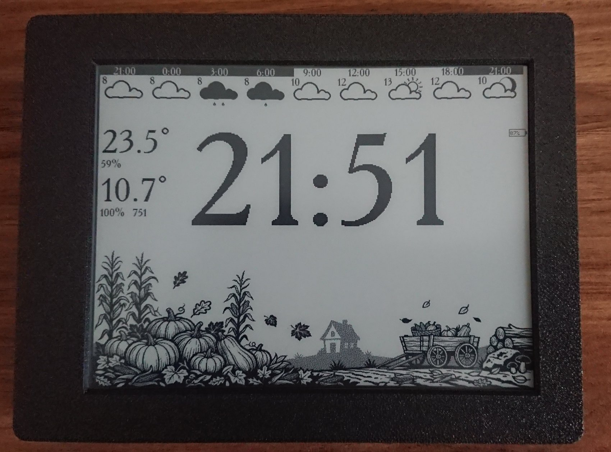

# Inkplate 6 E-Paper Dashboard Firmware

An optimized, low-power firmware for the **Inkplate 6** e-paper display, designed for off-grid or continuous environmental monitoring. The system wakes up periodically to update sensor metrics, fetch weather data, render a background image, and immediately return to deep sleep to conserve battery life.

## Features

- **Periodic E-Paper Refresh:** Updates the display every minute with the current time, weather forecast, sensor telemetry, and background artwork.
- **Aggressive Power Management:** Operates on a strict duty cycle—wakes up every minute to execute tasks and returns to deep sleep for maximum energy efficiency.
- **Optimized Network Scheduling:**
  - **Weather Data:** Fetched once per hour to minimize radio activity and power consumption.
  - **NTP Time Sync:** Synchronizes system time with an NTP server once every 24 hours.
- **Immediate Sensor Polling:** Reads local sensor data upon every wake cycle to capture real-time environmental changes.
- **Flexible Background Rendering:** Supports loading background images either from the onboard SD card or compiling them directly into the firmware binary (selectable via configuration).
- **Centralized Configuration:** All operational parameters, network credentials, and sensor settings are managed through a single `config.h` file.

## Image Converter Script (`img_convert.py`)

A zero-dependency Python utility (requires only `Pillow`) that converts background PNG images into C byte arrays and packs them into a single unified `image.h` header file for compilation into the firmware.

### Key Features & Requirements

- **Target Resolution:** All input images must be **800×250** to match the app layout boundaries.
- **Date-Based Naming Schema:** The script parses filename metadata to determine when each image should be displayed throughout the year:
  ```<month_start>-<month_end>_<day_start>-<day_end>_<comments>.png```


